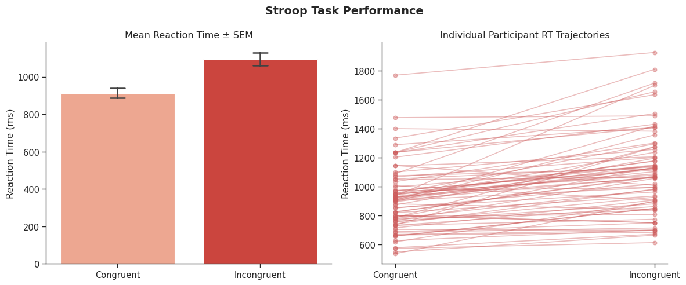
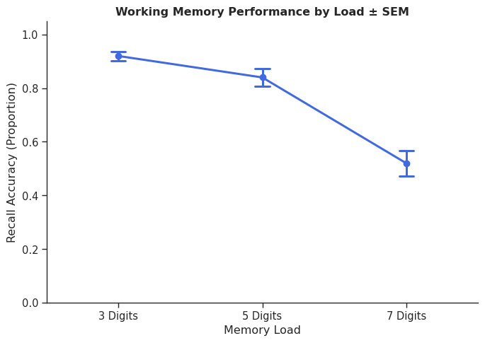
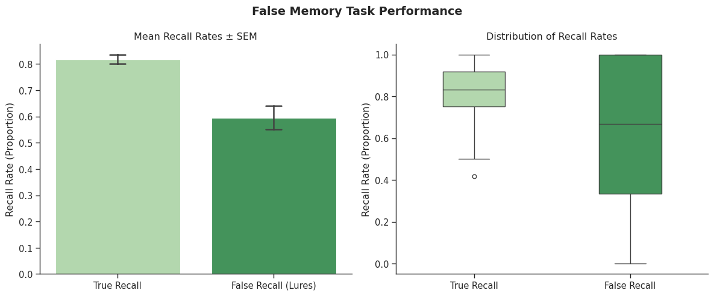

# Cognitive Experiment Platform (CEP)

[](index.html)
[](#)
[](#)

A client-side cognitive psychology experimentation platform built to measure **selective attention**, **working memory capacity**, and **reconstructive memory errors** in real time. 

The platform runs entirely in modern web browsers, provides millisecond-precision reaction timing, delivers on-screen Plotly.js analytics at the end of each session, and exports tidy, analysis-ready CSV records for downstream psychometric and statistical workflows.

---

## 📑 Table of Contents
- [Project Overview & Experimental Paradigms](#-project-overview--experimental-paradigms)
- [Primary Empirical Results](#-primary-empirical-results)
- [Core Experimental Visualizations](#-core-experimental-visualizations)
- [Key Cognitive Inferences & Deep Analysis](#-key-cognitive-inferences--deep-analysis)
- [Platform Architecture](#-platform-architecture)
- [Local Setup & Usage](#-local-setup--usage)
- [Detailed Results Reference](#-detailed-results-reference)

---

## 🔬 Project Overview & Experimental Paradigms

The platform contains three canonical experimental psychology tasks:

```
                      ┌────────────────────────────────────────┐
                      │   Participant Onboarding (Step 1 & 2)  │
                      │ (Demographics, Age, Gender, Sleep, ID) │
                      └───────────────────┬────────────────────┘
                                          │
         ┌────────────────────────────────┼────────────────────────────────┐
         ▼                                ▼                                ▼
┌──────────────────┐            ┌──────────────────┐             ┌──────────────────┐
│   Stroop Task    │            │  Working Memory  │             │   False Memory   │
│ (Attention & RT) │            │  (Complex Span)  │             │  (DRM Paradigm)  │
└────────┬─────────┘            └────────┬─────────┘             └────────┬─────────┘
         │                               │                                │
         └────────────────────────────────┼────────────────────────────────┘
                                          ▼
                      ┌────────────────────────────────────────┐
                      │   Real-Time Visual Analytics & CSV     │
                      │       (Plotly.js + Data Export)        │
                      └────────────────────────────────────────┘
```

### 1. Stroop Task (Attention & Executive Control)
- **Design**: 24 randomized trials presenting color words (*RED*, *BLUE*, *GREEN*) in congruent or incongruent font colors.
- **Task**: Identify font color as quickly and accurately as possible using keyboard bindings (`R`, `B`, `G`) or touch interfaces.
- **Measures**: Congruent RT, Incongruent RT, Stroop Interference Score ($\Delta \text{RT} = \text{RT}_{\text{Incongruent}} - \text{RT}_{\text{Congruent}}$), and condition-specific accuracy.

### 2. Working Memory Task (Operation / Complex Span)
- **Design**: 15 trials testing digit span capacity across varying loads (3, 5, and 7 digits) interleaved with an active distractor task.
- **Task**: Memorize sequential digits while simultaneously evaluating arithmetic equations (e.g., $8 + 5 = 13$, $14 - 9 = 5$).
- **Measures**: Load-dependent recall accuracy (3-, 5-, 7-digit), load effect degradation ($3 \rightarrow 7$), distractor math accuracy, and distractor response latency.

### 3. False Memory Task (Deese-Roediger-McDermott / DRM)
- **Design**: Timed serial presentation of semantically associated word lists (e.g., *sour, candy, sugar, bitter, taste*), omitting the central thematic critical lure (e.g., *sweet*).
- **Task**: Surprise recognition memory test assessing studied target items, non-presented critical lures, and unrelated control foils.
- **Measures**: True recall rate, critical lure false alarm rate, foil rejection rate, and intrusion rates.

---

## 📊 Primary Empirical Results

Based on empirical testing across **182 valid participants** ($M_{\text{age}} = 22.36 \pm 7.31$ years), the platform yielded clear, statistically validated cognitive effects:

| Paradigm | Primary Metric | Empirical Mean ($M$) | Standard Deviation ($SD$) | Statistical Significance | Effect Size |
|:---|:---|:---:|:---:|:---:|:---:|
| **Stroop** | Congruent Reaction Time | 913.41 ms | 226.64 ms | Baseline | — |
| **Stroop** | Incongruent Reaction Time | 1095.17 ms | 288.49 ms | $t(75) = 9.40$, $p = 2.61 \times 10^{-14}$ | Cohen's $d = 1.08$ |
| **Stroop** | Net Interference Score ($\Delta$ RT) | +181.72 ms | 168.65 ms | Highly Significant ($p < 0.001$) | Large |
| **Stroop** | Accuracy Drop (Congruent $\rightarrow$ Incongruent) | 95.29% $\rightarrow$ 88.60% | 14.2% $\rightarrow$ 22.0% | $t(75) = 2.64$, $p = 0.0101$ | Moderate |
| **Working Memory** | 3-Digit Span Accuracy | 92.00% | 12.12% | Near Ceiling | — |
| **Working Memory** | 5-Digit Span Accuracy | 84.00% | 22.50% | High Stability | — |
| **Working Memory** | 7-Digit Span Accuracy | 52.00% | 33.32% | $t(49) = 8.19$, $p = 9.70 \times 10^{-11}$ | Cohen's $d = 1.16$ |
| **Working Memory** | Distractor Math Accuracy | 98.53% | 3.38% | Ceiling Compliance | — |
| **False Memory** | True Item Recognition | 81.70% | 12.80% | Veridical Memory | — |
| **False Memory** | Critical Lure False Alarm Rate | 59.52% | 32.86% | $t(55) = 4.88$, $p = 9.49 \times 10^{-6}$ | Cohen's $d = 0.65$ |
| **False Memory** | Unrelated Foil Rejection Rate | 94.05% | 9.89% | High Discrimination | — |

---

## 📈 Core Experimental Visualizations

### 1. Stroop Task Performance (Selective Attention & Cognitive Interference)

*Figure 1: Mean reaction time (± SEM) under congruent vs. incongruent conditions demonstrating significant cognitive interference (+181.7 ms, $p < 10^{-13}$, Cohen's $d = 1.08$) alongside paired individual participant RT trajectories.*

### 2. Working Memory Complex Operation Span (Capacity Degradation)

*Figure 2: Recall accuracy across 3-digit, 5-digit, and 7-digit loads under continuous mathematical distractor interference. Note the sharp drop at 7 digits ($p = 9.70 \times 10^{-11}$, Cohen's $d = 1.16$), marking the boundary of the working memory buffer.*

### 3. DRM False Memory Paradigm (Semantic Reconstructive Error)

*Figure 3: True item recall rate vs. non-presented critical lure false recall rate (± SEM) alongside individual distribution boxplots. Demonstrates associative memory distortion with nearly 60% false recognition of semantic lures.*

---

## 🧠 Key Cognitive Inferences & Deep Analysis

A deeper statistical synthesis across the dataset reveals several critical inferences:

### 1. Dissociation Between Sensorimotor Speed and Executive Inhibition (Gender Comparison)
- Male participants exhibited significantly faster raw response times than female participants on both congruent trials ($856.9$ ms vs. $1005.0$ ms, $p = 0.0087$) and incongruent trials ($1034.7$ ms vs. $1193.1$ ms, $p = 0.0203$).
- **Crucial Inference**: Despite the ~150 ms raw latency gap, the **Stroop Interference Score was indistinguishable** between genders ($177.8$ ms for men vs. $188.1$ ms for women, $t = -0.265$, $p = 0.7917$, Cohen's $d = -0.06$).
- Furthermore, women achieved slightly higher accuracy on high-conflict incongruent trials ($91.1\%$ vs $87.1\%$). This confirms that the observed difference is attributable to a baseline sensorimotor response criterion / threshold rather than a difference in executive inhibitory control or conflict resolution.

### 2. Working Memory Capacity Collapse Under Complex Operation Span
- While standard simple digit spans often reach $7 \pm 2$ items (Miller's Law), participants in this complex span paradigm experienced a **sharp drop to 52.00% accuracy at 7 digits** ($p = 9.70 \times 10^{-11}$).
- **Crucial Inference**: With secondary arithmetic processing verified at near-ceiling accuracy (98.53%), participants could not rely on continuous articulatory rehearsal. The data aligns closely with Cowan’s embedded-processes model ($4 \pm 1$ items in the active focus of attention); once cognitive load exceeds 4–5 units under concurrent processing, memory decay is steep.

### 3. Reconstructive Gist vs. Random Guessing in DRM False Memory
- Participants falsely recognized non-presented critical lures **59.52% of the time**, while simultaneously rejecting unrelated foil items at **94.05% accuracy**.
- **Crucial Inference**: False memory is not driven by generalized perceptual uncertainty or an indiscriminate positive response bias. Rather, it validates spreading activation in semantic associative networks: mental representation of the thematic gist produces subjective recognition strength comparable to physical perception.

### 4. Domain Generality & Resilience Across Demographics
- **Academic Discipline**: One-Way ANOVAs comparing STEM (Computer Science, Engineering) vs. Humanities and Business students revealed no statistically significant differences in Stroop interference ($F = 0.64, p = 0.59$), 7-digit recall ($F = 1.44, p = 0.24$), or false lure recall ($F = 1.26, p = 0.30$).
- **Sleep Duration**: Self-reported sleep (range: 3–10 hrs) showed no significant correlation with Stroop interference ($r = -0.108, p = 0.36$), high-load recall ($r = -0.023, p = 0.88$), or false lure rates ($r = +0.103, p = 0.47$).
- **Inference**: Fundamental cognitive control structures and semantic architecture operate as robust neurocognitive invariants across acute lifestyle variations and academic specializations.

---

## 💻 Platform Architecture

The repository is structured with pure modular vanilla JavaScript and zero runtime dependencies:

```
COgnitive dashboard/
├── assets/
│   ├── stroop_task_performance.png   # Stroop RT & participant trajectories
│   ├── working_memory_capacity.png    # Working memory load performance
│   └── false_memory_performance.png   # DRM true vs. false recall rates
├── index.html                         # Main UI single-page application (4-stage flow)
├── style.css                          # Responsive styling, CSS tokens, and theme system
├── app.js                             # State management, onboarding logic, routing
├── stroop.js                          # Stroop engine, stimulus scheduler, timing
├── memory.js                          # Working memory engine, distractor math equations
├── falseMemory.js                     # DRM paradigm controller, word lists
├── data.js                            # Stimulus banks, word pairs, arithmetic seeds
├── export.js                          # Metrics computation, Plotly rendering, CSV export
└── results/
    └── findings.md                    # Full statistical tables, ANOVA outputs, t-tests
```

### Key Technical Characteristics
- **Millisecond Precision**: Utilizes `performance.now()` timestamps for low-latency stimulus presentation and response capture.
- **Zero-Dependency Core**: Runs out of the box on any modern browser without npm build steps or backend servers.
- **In-Browser Data Visualization**: Leverages [Plotly.js](https://plotly.com/javascript/) CDN to render immediate feedback plots and accuracy bars upon task completion.
- **Standardized Export**: Emits tidy CSV rows including participant metadata (ID, age, gender, major, sleep) and summary metrics.

---

## 🚀 Local Setup & Usage

### 1. Clone the Repository
```bash
git clone https://github.com/tshrayansh/Cognitive-Dashboard.git
cd Cognitive-Dashboard
```

### 2. Run Locally
Because the application is static client-side web software, you can open `index.html` directly in any web browser, or serve it using any lightweight local HTTP server:

```bash
# Using Python 3
python3 -m http.server 8000

# Or using Node.js npx
npx serve .
```
Navigate to `http://localhost:8000` to begin experimenting.

---

## 📖 Detailed Results Reference

For the full statistical output tables, ANOVA breakdowns across age groups and majors, and complete Welch's $t$-test tables across all 17 behavioral metrics, please refer to the dedicated documentation:

👉 **[results/findings.md](results/findings.md)**
