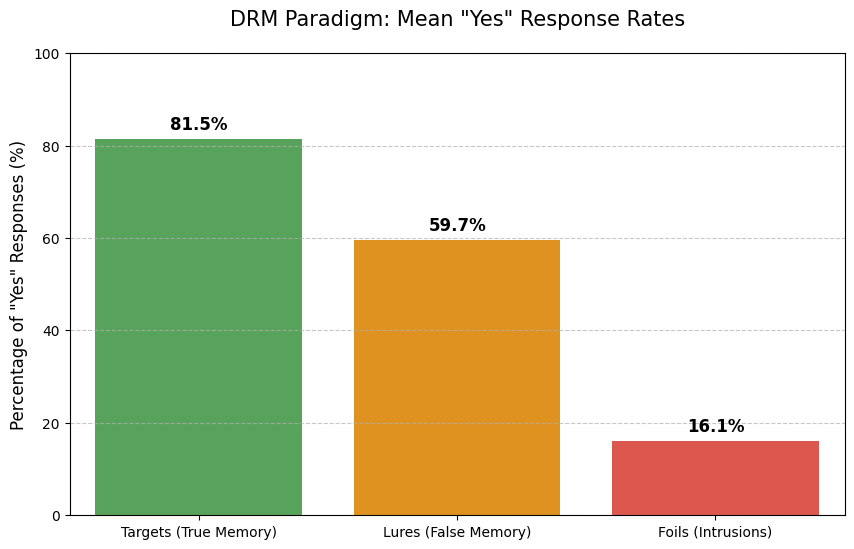
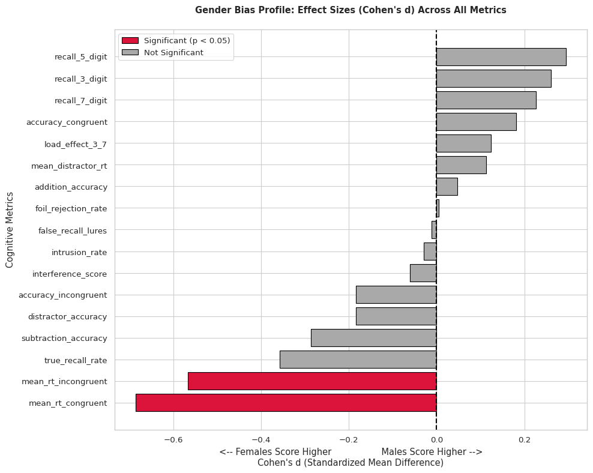

# Experimental Findings & Detailed Statistical Analysis

This document provides a granular statistical breakdown and empirical report for data collected via the **Cognitive Experiment Platform (CEP)**, analyzing **182 valid participants** across three classic experimental psychology paradigms: **Stroop Task**, **Working Memory (Complex Span)**, and **False Memory (DRM Paradigm)**.

---

## 1. Sample Demographics & Preprocessing

- **Total Sessions Recorded**: 197 raw session records
- **Valid Analysis Cohort**: $N = 182$ participants (after removing missing and extreme outlier demographic entries; age range: 18–69 years, $M = 22.36$, $SD = 7.31$)
- **Cohort Breakdown by Task**:
  - **Stroop Task**: $N = 76$
  - **Working Memory Task**: $N = 50$
  - **False Memory Task**: $N = 56$
- **Demographic Distributions**:
  - **Gender**: Male = 101 (55.5%), Female = 79 (43.4%), Other = 2 (1.1%)
  - **Age Groups**: Teens ($\le 19$: 13.2%), Early 20s (20–21: 60.4%), Older ($\ge 22$: 25.3%)
  - **Reported Sleep Duration**: Range: 3.0–10.0 hours (Cleaned $M = 6.42$, $SD = 1.34$ hours; extreme unverified inputs such as 0, 25, 99 hours filtered out)
  - **Academic Disciplines**: Computer Science & IT, Engineering, Natural Sciences, Business & Finance, Humanities & Social Sciences.

---

## 2. Granular Task Results

### 2.1 Stroop Task (Selective Attention & Executive Inhibition)

Participants identified ink colors while ignoring conflicting semantic word meanings across 24 randomized trials (congruent vs. incongruent).

| Metric | Mean ($M$) | Standard Deviation ($SD$) | Median | Min | Max |
|:---|:---:|:---:|:---:|:---:|:---:|
| **Congruent RT (ms)** | 913.41 | 226.64 | 905.00 | 537.00 | 1768.00 |
| **Incongruent RT (ms)** | 1095.17 | 288.49 | 1081.50 | 609.00 | 1957.00 |
| **Interference Score ($\Delta$ RT, ms)** | 181.72 | 168.65 | 167.00 | -183.00 | 703.00 |
| **Congruent Accuracy (%)** | 95.29% | 14.22% | 100.00% | 0.00% | 100.00% |
| **Incongruent Accuracy (%)** | 88.60% | 21.98% | 100.00% | 0.00% | 100.00% |

#### Statistical Hypothesis Testing
- **Reaction Time Interference**:
  - Paired $t$-test ($RT_{\text{Incongruent}}$ vs $RT_{\text{Congruent}}$): $t(75) = 9.40$, $p = 2.61 \times 10^{-14}$
  - Effect Size: Cohen's $d = 1.078$ (Large effect)
  - *Result*: Participants were on average **181.7 ms slower** when responding to incongruent stimuli, verifying robust cognitive interference.
- **Accuracy Comparison**:
  - Paired $t$-test: $t(75) = 2.64$, $p = 0.0101$, Cohen's $d = 0.303$
  - *Result*: Accuracy dropped significantly from 95.3% to 88.6% under cognitive conflict.

---

### 2.2 Working Memory (Complex Operation Span)

Participants memorized sequential digit strings (loads of 3, 5, and 7 digits) while solving interleaved mental arithmetic equations (e.g., $7 + 4 = 11$, $15 - 8 = 7$).

| Metric | Mean ($M$) | Standard Deviation ($SD$) | Median | Min | Max |
|:---|:---:|:---:|:---:|:---:|:---:|
| **Recall Accuracy (3 Digits)** | 92.00% | 12.12% | 100.00% | 60.00% | 100.00% |
| **Recall Accuracy (5 Digits)** | 84.00% | 22.50% | 100.00% | 0.00% | 100.00% |
| **Recall Accuracy (7 Digits)** | 52.00% | 33.32% | 50.00% | 0.00% | 100.00% |
| **Load Effect (3 vs 7 Digit Drop)** | -40.00% | 34.46% | -40.00% | -100.00% | 20.00% |
| **Distractor Math Accuracy** | 98.53% | 3.38% | 100.00% | 86.70% | 100.00% |
| **Mean Distractor RT (ms)** | 2956.16 | 727.14 | 2953.00 | 1716.00 | 4551.00 |
| **Addition Math Accuracy** | 98.97% | 4.12% | 100.00% | 85.70% | 100.00% |
| **Subtraction Math Accuracy** | 98.15% | 4.88% | 100.00% | 80.00% | 100.00% |

#### Statistical Hypothesis Testing
- **3-Digit vs. 5-Digit Load**: $t(49) = 2.92$, $p = 0.0053$, Cohen's $d = 0.413$
- **5-Digit vs. 7-Digit Load**: $t(49) = 7.35$, $p = 1.89 \times 10^{-9}$, Cohen's $d = 1.040$
- **3-Digit vs. 7-Digit Load**: $t(49) = 8.19$, $p = 9.70 \times 10^{-11}$, Cohen's $d = 1.159$
- *Integrity of Distractor Processing*: Overall arithmetic accuracy was 98.53% ($M_{RT} \approx 2.96$ s), proving participants did not sacrifice distractor computation to covertly rehearse digits.

---

### 2.3 False Memory (Deese-Roediger-McDermott Paradigm)

Participants studied lists of semantically related words (e.g., *sour, candy, sugar, bitter*) without seeing the central thematic lure (*sweet*), followed by a surprise recognition test.

| Metric | Mean ($M$) | Standard Deviation ($SD$) | Median | Min | Max |
|:---|:---:|:---:|:---:|:---:|:---:|
| **True Recall Rate (Targets)** | 81.70% | 12.80% | 83.30% | 41.70% | 100.00% |
| **Critical Lure False Recall Rate** | 59.52% | 32.86% | 66.70% | 0.00% | 100.00% |
| **Foil Rejection Rate (True Negatives)**| 94.05% | 9.89% | 100.00% | 50.00% | 100.00% |
| **Unrelated Intrusion Rate** | 16.13% | 10.41% | 13.30% | 0.00% | 46.70% |

#### Statistical Hypothesis Testing
- **True Recall vs. Critical Lure False Recall**:
  - Paired $t$-test: $t(55) = 4.88$, $p = 9.49 \times 10^{-6}$, Cohen's $d = 0.652$
  - *Result*: While true items are recognized at a higher rate (81.7%), non-presented critical lures are falsely recognized nearly 60% of the time.
- **Critical Lure vs. Foil Rejection**:
  - Participants correctly rejected unrelated foils 94.05% of the time ($5.95\%$ false alarm rate on foils vs. $59.52\%$ on lures).
  - *Result*: Confirms that false memory is strongly driven by semantic activation networks rather than indiscriminate guessing or positive response bias.

*Figure: Mean "Yes" recognition rates across Target items (81.7%), Critical Lures (59.5%), and Unrelated Foils (16.1%).*

---

## 3. Demographic & Group-Level Analyses

### 3.1 Gender Differences Across Behavioral Metrics (Welch's $t$-Tests)

Comparing Male ($n \in [27, 47]$ depending on task) vs. Female ($n \in [24, 29]$):

| Task Domain | Metric | Male Mean | Female Mean | $t$-statistic | $p$-value | Cohen's $d$ | Statistically Significant |
|:---|:---|:---:|:---:|:---:|:---:|:---:|:---:|
| **Stroop** | Congruent RT (ms) | 856.87 | 1005.03 | -2.735 | **0.0087** | -0.685 | **Yes ($p < 0.01$)** |
| **Stroop** | Incongruent RT (ms) | 1034.72 | 1193.14 | -2.385 | **0.0203** | -0.566 | **Yes ($p < 0.05$)** |
| **Stroop** | Interference Score ($\Delta$ RT, ms) | 177.81 | 188.07 | -0.265 | **0.7917** | -0.061 | No |
| **Stroop** | Congruent Accuracy (%) | 96.28% | 93.69% | 0.711 | 0.4809 | 0.182 | No |
| **Stroop** | Incongruent Accuracy (%) | 87.06% | 91.10% | -0.843 | 0.4022 | -0.184 | No |
| **Memory** | 3-Digit Accuracy (%) | 93.33% | 90.00% | 0.926 | 0.3589 | 0.261 | No |
| **Memory** | 5-Digit Accuracy (%) | 85.93% | 79.17% | 1.022 | 0.3134 | 0.294 | No |
| **Memory** | 7-Digit Accuracy (%) | 53.33% | 45.83% | 0.809 | 0.4227 | 0.226 | No |
| **Memory** | Load Effect (3–7) | -40.00% | -44.17% | 0.442 | 0.6598 | 0.124 | No |
| **Memory** | Distractor Math Accuracy (%) | 98.27% | 98.89% | -0.659 | 0.5125 | -0.184 | No |
| **Memory** | Mean Distractor RT (ms) | 3272.59 | 3068.54 | 0.423 | 0.6741 | 0.113 | No |
| **False Memory** | True Recall Rate (%) | 80.46% | 84.62% | -1.338 | 0.1865 | -0.358 | No |
| **False Memory** | Critical Lure Recall (%) | 58.62% | 58.98% | -0.040 | 0.9684 | -0.011 | No |
| **False Memory** | Foil Rejection Rate (%) | 93.96% | 93.91% | 0.019 | 0.9853 | 0.005 | No |
| **False Memory** | Intrusion Rate (%) | 15.92% | 16.22% | -0.106 | 0.9158 | -0.029 | No |

*Figure: Standardized Effect Sizes (Cohen's d) across all 17 cognitive and behavioral metrics comparing Men vs. Women. Only raw reaction times reached significance ($p < 0.05$); core interference and accuracy metrics remain gender-invariant.*

---

### 3.2 Age Effects (One-Way ANOVA Across Age Brackets)

Categorized into: Teens ($\le 19$), Early 20s ($20\text{--}21$), Older ($\ge 22$):

| Dependent Variable | $F$-statistic | $p$-value | Interpretation |
|:---|:---:|:---:|:---|
| **Stroop Incongruent RT** | 2.751 | 0.070 | Trend toward slight slowing in older bracket; non-significant at $\alpha = 0.05$ |
| **Stroop Interference Score** | 0.282 | 0.755 | Uniform conflict processing across ages |
| **Working Memory (7-Digit Recall)** | 0.777 | 0.466 | Equivalent capacity ceiling across age groups |
| **False Memory (Intrusion Rate)** | 0.333 | 0.719 | Equal susceptibility to semantic intrusions |

---

### 3.3 Academic Discipline Effects (One-Way ANOVA)

Examining whether cognitive performance varies by academic domain (CS/IT, Engineering, Natural Sciences, Business, Humanities):

| Task Domain & Measure | $F$-statistic | $p$-value | Conclusion |
|:---|:---:|:---:|:---|
| **Stroop Interference Score** | 0.640 | 0.5902 | No domain-specific advantage in executive attention |
| **Working Memory (7-Digit Recall)** | 1.440 | 0.2449 | Working memory capacity limits are domain-general |
| **False Memory (Lure Recall)** | 1.260 | 0.2992 | Semantic lure activation is universal |

---

### 3.4 Sleep Duration Analysis

Testing correlations between self-reported prior-night sleep duration (cleaned: 3–10 hours) and performance metrics:

| Correlation Pair | Pearson $r$ | $p$-value | Interpretation |
|:---|:---:|:---:|:---|
| **Sleep vs. Stroop Interference Score** | -0.108 | 0.3647 | No significant association |
| **Sleep vs. Stroop Incongruent RT** | -0.080 | 0.4995 | No significant motor slowing from acute variations |
| **Sleep vs. Working Memory (7-Digit Recall)** | -0.023 | 0.8753 | High-load memory retention intact across typical sleep ranges |
| **Sleep vs. False Memory Intrusion Rate** | +0.046 | 0.7443 | Reconstructive memory errors independent of sleep variation |
| **Sleep vs. Critical Lure Recall** | +0.103 | 0.4653 | Semantic activation resilient to acute sleep fluctuations |

